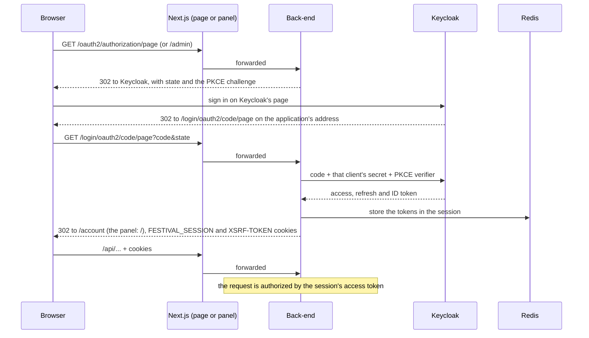

# Authentication

The application never handles a credential. Keycloak (realm `festival`) owns every page that touches one: sign-up,
sign-in, email verification, password reset, two-factor authentication and acceptance of the terms of use. The
back-end is a BFF: it signs the user in, keeps the tokens in its session and gives the browser only a session cookie.

## Two clients

The festival page and the admin panel sign in with separate Keycloak clients, each with its own secret and redirect
address:

| Client           | Application | Lands on, after sign-in | Who may sign in                        |
|------------------|-------------|-------------------------|----------------------------------------|
| `festival-page`  | the page    | `/account`              | any account with a verified email      |
| `festival-admin` | the panel   | `/`                     | an account with the `ADMIN` realm role |

`FestivalOidcUserService` refuses an account without a verified email, and refuses the admin client to anyone without
`ADMIN`. A refused or failed sign-in lands on the application's failure path (`?loginError=true`).

## Signing in

1. The application sends the browser to `/oauth2/authorization/page` or `/oauth2/authorization/admin`, which Next.js
   forwards to the back-end. `LocalizedAuthorizationRequestResolver` builds the authorization request with PKCE and
   passes the language from the `NEXT_LOCALE` cookie.
2. Keycloak returns to `/login/oauth2/code/{client}` on the application's own address. Spring Security exchanges the
   code with that client's secret and keeps the tokens in the HTTP session.
3. `LoginRedirectHandler` sends the browser to the client's landing path.

The browser holds only the `FESTIVAL_SESSION` cookie (`HttpOnly`, `SameSite=Lax`, `Secure` in production) and the
`XSRF-TOKEN` cookie. `GET /api/me` tells the application who is signed in and whether they are an administrator.

## Account actions

The account page changes the password and turns the second factor on and off on Keycloak's own pages, so no password
and no TOTP secret passes through the application. `GET /api/account/second-factor` reads the caller's OTP credential
from Keycloak's account API (`/realms/festival/account/credentials`) with the caller's own access token, which carries
the `account` audience and the `manage-account` role every account gets, so the application needs no right to read
anyone else's credentials. The page then sends the signed-in browser to `/oauth2/authorization/page?kc_action=…`, and
`LocalizedAuthorizationRequestResolver` passes `kc_action` on to Keycloak when it is `UPDATE_PASSWORD`,
`CONFIGURE_TOTP` or `delete_credential:<id>` with a UUID, and drops any other value. Keycloak shows only that page,
asks to confirm a removal and removes a credential only when it is the person's own, then returns through the usual
sign-in to the client's landing path.

## Every API request is authorized by a token

For a request to `/api/*` with a session, `SessionAccessTokenFilter` takes the access token from the session,
refreshing it when it is about to expire, and authorizes the request with that token rather than with the session. The
token is verified like any resource server's: the signature against Keycloak's published keys, the issuer, the expiry
and the audience (`festival-api`). `ADMIN` in the token's realm roles becomes `ROLE_ADMIN`, so revoking it in Keycloak
cuts admin access within minutes.

A client without a browser calls the same API with `Authorization: Bearer` and its own Keycloak token; the same checks
apply.

## Sessions and refreshing

The session lives in Redis for ten hours, and its access token is refreshed once per refresh token, across instances:
[Token refresh](../backend/docs/mechanisms/token-refresh.md).

## Signing out

The application posts to `/logout`. The back-end ends its session and answers with Keycloak's end-session address for
the client the user signed in with, carrying the ID token; the browser follows it, Keycloak ends its session and returns
to the application's home page.

## CSRF

Every unsafe request repeats the `XSRF-TOKEN` cookie in a header: [CSRF](mechanisms/csrf.md).

## The sign-in pages

Keycloak draws the sign-in, sign-up, password reset and second-factor pages, and the mails it sends, with the theme in
[`keycloak/themes`](../keycloak/themes), so they look like the application the reader signs in to:

| Part                      | Holds                                                                                              |
|---------------------------|----------------------------------------------------------------------------------------------------|
| `login/theme.properties`  | extends `keycloak.v2`, whose templates draw every page, and names the legal pages                  |
| `login/template.ftl`      | the page frame: a top bar with the name and the menus, a footer with the legal pages               |
| `login/resources`         | `css/app.css`, the colors, type and card on PatternFly; `js/language.js`, the language handed back |
| `login/messages`          | the texts of the bar and the footer, in Polish and English                                         |
| `email/html/template.ftl` | the frame of every mail; its texts stay Keycloak's own                                             |

The pages are light only, as the app is: `darkMode=false` in `theme.properties` turns off Keycloak's dark mode, and the
theme menu with it.

There are two themes, one per client. `festival-page`, the realm's `loginTheme` and `emailTheme`, draws the site's look,
and `festival-admin`, set on the `festival-admin` client as its `login_theme` attribute, the panel's indigo screen,
without a footer, as the panel has no legal pages. Mails always come in the site's look.

The language goes both ways. The sign-in page opens in the application's language, sent as `ui_locales`; Keycloak shows
a signed-in person their account's language instead, so before an account action `KeycloakLanguageFilter` stores the
application's language on the account, with the person's own token, through Keycloak's account API. A language chosen in
Keycloak's own menu goes back to the application, as the sign-in returns to an address that carries nothing else:
`language.js` leaves it in the cookie `ui_locale_festival`, under the domain Keycloak shares with the application, the
parent of Keycloak's host (on localhost, every port), and `KeycloakLanguageFilter` takes it over into the `NEXT_LOCALE`
cookie when the sign-in returns to `/login/oauth2/code/{client}`, and removes it.

`template.ftl` is a copy of `keycloak.v2`'s own, changed only where it says `Changed from keycloak.v2`. Keycloak builds
its pages from that template, so after an upgrade of Keycloak the copy is compared with the new release's and brought up
to date. The Keycloak theme workflow does the comparison: `keycloak/check-template.sh` fails when the template in the
Keycloak image of `docker-compose.local.yml` is not the one the copy was made from, recorded as `parentTemplateSha256`
in `theme.properties`, which changes with the copy. The colors are those of `frontend/apps/page/styles/globals.css` and
`frontend/apps/admin/styles/globals.css`. A mail's colors are written as hex, since mail clients read neither `oklch()`
nor `light-dark()`. The links of the bar and the footer lead to the client's base URL, `baseUrl` in the realm.

The realm names the theme in `loginTheme` and `emailTheme`. Locally, compose mounts the folder into Keycloak. A Keycloak
that serves several applications, each in its own realm, takes it as a JAR in `/opt/keycloak/providers`:
`keycloak/build-theme.sh` writes `keycloak/target/festival-keycloak-themes.jar`, and `keycloak/Dockerfile` builds an
image holding it in `/themes`, which the Keycloak theme workflow publishes on a `keycloak-theme-v*` tag.

## Code

All in `backend/src/main/java/com/vertyll/festival/security` unless noted:

| Class                                                 | Role                                              |
|-------------------------------------------------------|---------------------------------------------------|
| `SecurityConfig`                                      | the filter chain, both client registrations, CSRF |
| `FestivalOidcUserService`                             | verified email, the admin client's role check     |
| `LocalizedAuthorizationRequestResolver`               | PKCE and the language                             |
| `LoginRedirectHandler`                                | landing and failure paths per client              |
| `SessionAccessTokenFilter`, `SessionAccessTokens`     | a session's request authorized by its token       |
| `SingleFlightRefreshTokenProvider`, `SharedRefreshes` | one refresh per refresh token                     |
| `LogoutUrlResponder`                                  | Keycloak's end-session address                    |
| `frontend/packages/shared/src/auth/session.tsx`       | signing in and out from the applications          |
